<a href="https://github.com/LBEILC/StrongholdAssistant/releases/latest">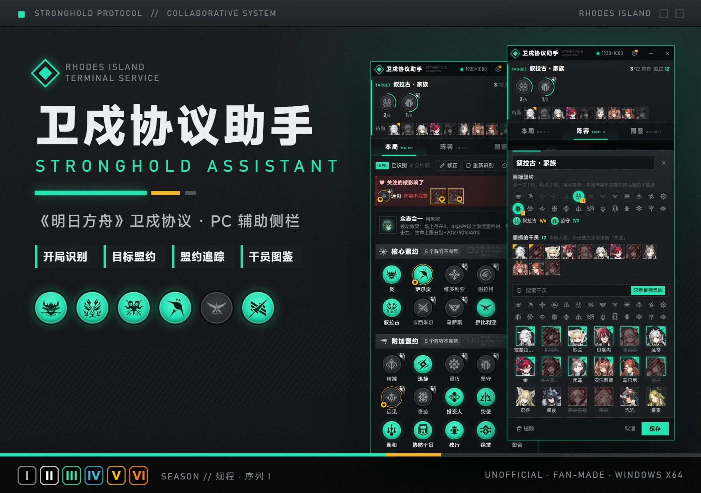</a>

<p align="center">
  <a href="https://github.com/LBEILC/StrongholdAssistant/releases/latest"></a>
  <a href="LICENSE"></a>
  <a href="#安装"></a>
  <a href="https://github.com/LBEILC/StrongholdAssistant/issues"></a>
  <a href="https://qm.qq.com/q/AuRBCSxWEg"></a>
  <br>
  <sub>GitHub 下不动？已有 Mirror酱 CDK 可以 <a href="https://mirrorchyan.com/zh/projects?rid=StrongholdAssistant">前往 Mirror酱 高速下载</a></sub>
</p>

<p align="center">
  贴在游戏窗口旁边的卫戍协议侧栏，陪你打完一整局：<br>
  <b>开局</b> 自动录入盟约、禁用和敌人 → <b>选阵容</b> 定好目标和回合阶段 → <b>商店</b> 里给要买的卡描框、算下回合的钱 → <b>打完</b> 自动记进历史。
</p>

<p align="center">
  QQ 交流群 <b>1132134217</b> · <a href="https://qm.qq.com/q/AuRBCSxWEg">点击链接加入群聊【卫戍小助手StrongholdAssistant交流群】</a>
</p>

<br>

<a name="安装"></a>
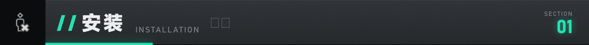

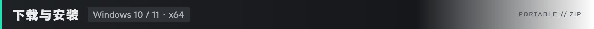

<table>
<tr>
<td width="120"></td>
<td>在 <a href="https://github.com/LBEILC/StrongholdAssistant/releases/latest"><b>Releases</b></a> 下载 <b>安装包</b> <code>StrongholdAssistant-v版本号-setup.exe</code>（推荐），或 <b>免安装版</b> <code>StrongholdAssistant-v版本号-win-x64.zip</code>。不要下 Source code。GitHub 下不动的话，已有 Mirror酱 CDK 可以 <a href="https://mirrorchyan.com/zh/projects?rid=StrongholdAssistant">前往 Mirror酱 高速下载</a>。</td>
</tr>
<tr>
<td></td>
<td><b>安装包</b>：双击运行，装在当前用户目录，不需要管理员权限，会建开始菜单和桌面快捷方式。<b>免安装版</b>：右键 <b>全部解压</b> 到一个单独的文件夹，保留里面的全部文件。都不需要另外安装 .NET。</td>
</tr>
<tr>
<td></td>
<td>从开始菜单或桌面打开 <b>卫戍协议助手</b>（免安装版双击 <b>StrongholdAssistant.exe</b>）。找到游戏窗口后，侧栏自动贴到游戏右侧；拖动后会记住相对位置，跟着游戏走。</td>
</tr>
<tr>
<td>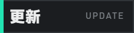</td>
<td>启动时自动检查新版本（设置里可以关），有新版本点 <b>更新</b>，下载校验后自动安装并重启。阵容、设置和历史存在 <code>%AppData%\StrongholdAssistant</code>，更新不会动它们。</td>
</tr>
<tr>
<td>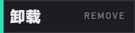</td>
<td><b>安装包</b>：在系统的「应用」里卸载，会问是否连阵容和设置一起删（默认保留）。<b>免安装版</b>：删掉解压出来的文件夹；想连数据一起删，再删 <code>%AppData%\StrongholdAssistant</code>。</td>
</tr>
</table>

> [!WARNING]
> 程序还没有代码签名，Windows SmartScreen 可能提示「Windows 已保护你的电脑」，点 **更多信息 → 仍要运行**。

<br>


1. **开局**：进卫戍协议后停在 **「确认本局信息」** 页，侧栏自动录入盟约、禁用干员、敌方领袖和特训敌人。禁用列表长，就点 **持续识别** 再慢慢往下滚，看全后点 **停止**。录错了右键改，没认出的问号格点开选。**单人模式** 进对局后点左上角回合数旁的放大镜打开 **对局详情**，会自动识别。
2. **定目标**：在 **阵容** 里新建一套，或者从 **我的阵容**、**广场**、分享码、森空岛攻略里拿一套，点 **设为目标**。
3. **商店**：要买的干员和装备都在侧栏顶部的 **追踪列表** 里，游戏商店里会给这些卡描框；本局页顶部写着回合、资金和下回合大约有多少钱。不想再标的，点一下头像取消。
4. **打完**：这一局自动记进 **历史**。点 **清空** 清掉本局信息，准备下一局。

> [!TIP]
> 侧栏挡视线时：点标题栏的收起按钮缩成细条，或者按快捷键（默认 <kbd>Alt</kbd>+<kbd>S</kbd>）；编阵容、逛广场嫌窄，点 **展开为工作台** 变成宽窗口。全屏或右边放不下时，侧栏盖在游戏画面左侧。

<br>

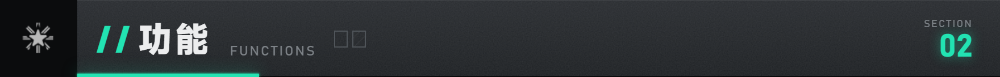

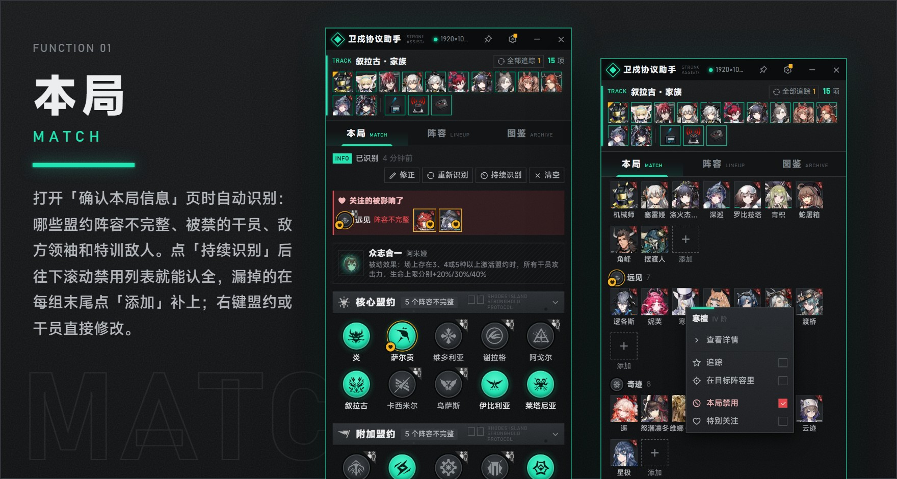

| 功能 | 说明 |
| --- | --- |
| **开局识别** | 打开「确认本局信息」页自动截图识别：哪些核心 / 附加盟约阵容不完整、敌方领袖、特训敌人。识别失败会说明原因，可以重新识别或导出诊断包发给我们，不会覆盖已有结果。 |
| **禁用干员** | 直接认头像（换了皮肤、精二的也认得），再按不完整的盟约推算；宁可漏认也不认错。按游戏的盟约分组和顺序排，没认出的格子留成问号格，只可能是一个人时直接填上并标「推测」。 |
| **单人模式** | 每局第一次打开对局详情时自动识别，之后反复打开不再重读。 |
| **回合与资金** | 商店画面里顺带读出回合、资金、调度中心等级和升级价，算出下回合大约有多少钱。每回合发多少钱从你自己的对局里学；策略在本局页选，利滚利、得闲饮茶等按策略算。 |
| **特别关注** | 标记熟悉的盟约和关键叠层干员，本局被禁时在本局页顶部醒目提示。 |
| **右键菜单** | 盟约、干员、装备、阵容卡都能右键：改阵容不完整、标记禁用、追踪、加入目标、特别关注。 |

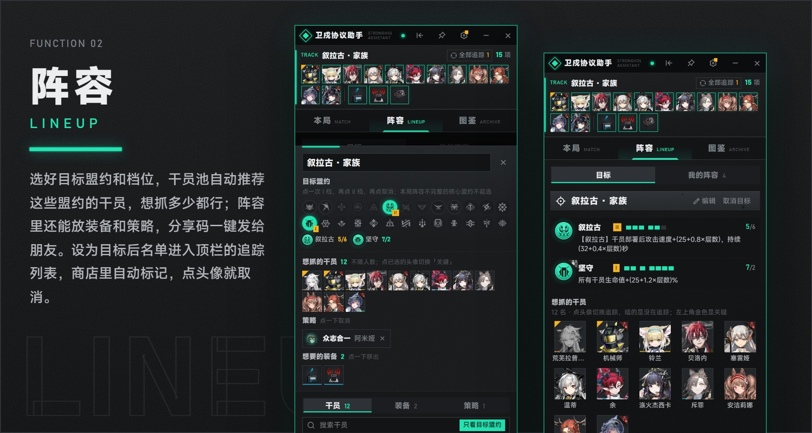

| 功能 | 说明 |
| --- | --- |
| **阵容** | 目标盟约（I / II 档）+ 想抓的干员 + 想要的装备 + 配合的策略，不限数量。干员池按目标盟约推荐，被禁的变暗；每名干员可以配优先 / 候选装备，标精锐、选技能和模组。 |
| **回合阶段** | 照森空岛攻略，在成型阵容前面加「1～3 回合」「过渡」这样的阶段。目标页按读到的回合自动切换，追踪和商店标记跟着换，后面阶段的关键干员提前标出来。 |
| **追踪列表** | 侧栏顶部一直显示追踪中的干员和装备，也就是商店里会标记的全部内容。设为目标时自动加进来；点头像取消，**全部追踪** 加回来。 |
| **商店标记** | 游戏商店里给整张卡描框：关键干员金色「关键」、追踪中的薄荷绿「追踪」、目标盟约里其他还能抓的虚线「可抓」。按 <kbd>D</kbd> 刷新商店时标记立刻撤掉，认出新商店再标（刷新键可改）。 |
| **本局可用** | 我的阵容按本局目标盟约是否完整、被禁人数排序，被禁的干员直接标出来。 |
| **分享与导入** | 右键阵容「复制分享码」，发到群里，别人粘贴整句就能导入，不经过任何服务器。也能粘贴森空岛攻略链接按阶段导入，或用自己的森空岛战绩生成阵容。 |
| **阵容广场** | 看大家分享的阵容，默认按本局能不能用排，点赞、收藏、一键导入；右键阵容「发布到广场」。网站 <a href="https://sa.lubeiluchen.com">sa.lubeiluchen.com</a> 也能浏览和新建，点「在助手里打开」直接唤起助手。浏览和导入不用登录，发布和点赞用邮箱登录。 |
| **云同步** | 登录广场后可以打开「同步我的阵容和偏好」，换电脑、在网站上都能用和改；默认关。 |

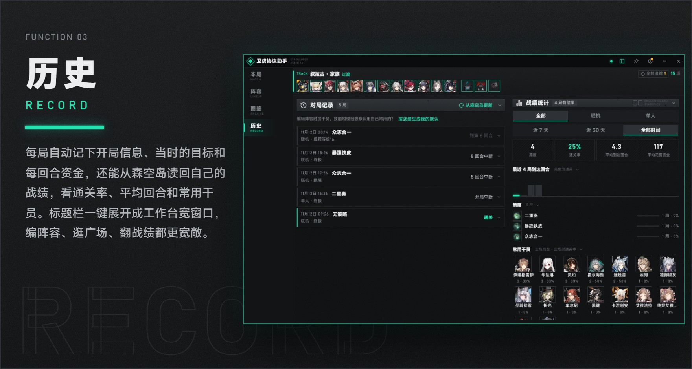

| 功能 | 说明 |
| --- | --- |
| **对局记录** | 每局自动记下开局信息、当时的目标和每回合资金；能从森空岛读回自己的战绩合成一条。 |
| **战绩统计** | 按联机 / 单人、近 7 天 / 30 天看通关率、平均到达回合、平均花费，以及各策略和常用干员的表现。 |
| **工作台** | 标题栏 **展开为工作台** 变成宽窗口，左边导航、右边详情，编阵容、逛广场、翻战绩更方便；收回就回到游戏旁边。启动时打开侧栏还是工作台可以在设置里选。 |
| **快捷键** | 默认 <kbd>Alt</kbd>+<kbd>S</kbd> 收起、展开侧栏，游戏在前台也能按。也可以设成单个键（只在游戏或助手在前台时生效，按键照样传给游戏）。 |

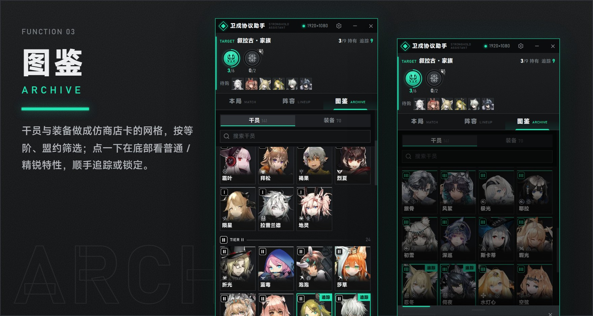

| 功能 | 说明 |
| --- | --- |
| **干员图鉴** | 仿商店卡的网格，按等阶、盟约、追踪中、关注筛选，可以隐藏本局禁用。详情里普通和精锐特性同屏对照、变化的数字高亮；还能设「我的默认」技能和模组。 |
| **装备图鉴** | 按等阶和功能（攻击、防御、生存、技力、经济、盟约…）筛选；写明能和什么合成、变形成什么、哪些干员获得时会给它。 |
| **策略 / 首领** | 全部策略的发起者和效果，可搜索；每个敌方领袖各难度的血量。本局用到的都排在最前。 |
| **设置与数据** | 游戏主题、界面大小、收起方式、更新日志都在设置里。阵容、关注和偏好能导出成备份文件，换电脑后导入。 |

<br>

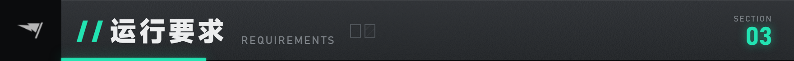

<table>
<tr>
<td width="120">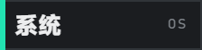</td>
<td><b>Windows 10 / 11，64 位（x64）</b>。</td>
</tr>
<tr>
<td>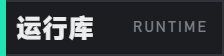</td>
<td>界面用 <b>Microsoft Edge WebView2</b> 显示，Windows 11 自带，Windows 10 一般也已安装；没有的话到 <a href="https://developer.microsoft.com/microsoft-edge/webview2/">微软官网</a> 装 Evergreen 版本。.NET 和识别用的运行库已经打包。</td>
</tr>
<tr>
<td>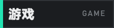</td>
<td>《明日方舟》PC 版，或 <b>MuMu 模拟器</b>（设置里「游戏来源」默认自动，先找 PC 客户端，再找 MuMu；用 ADB 截图）。当前数据对应 <b>卫戍协议 · 规程 · 序列 I</b>（141 名干员、70 件装备、26 个盟约）。</td>
</tr>
<tr>
<td>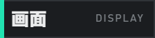</td>
<td>宽高比 3:2 到 16:9 的画面（1920×1080、2K、4K、16:10 都验证过）；比 16:9 更宽的带鱼屏可能识别不全。游戏里的 <b>界面缩放</b>（90～100）会自动识别，不用改。侧栏的 <b>界面大小</b> 默认跟随游戏画面。</td>
</tr>
</table>


<table>
<tr>
<td width="120">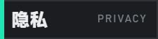</td>
<td>只通过截屏识别游戏画面：不读游戏内存，不注入游戏，不向游戏发送点击或按键。识别开局信息时如果侧栏挡住了画面，会短暂隐藏侧栏、把游戏切到前台再截图。</td>
</tr>
<tr>
<td>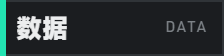</td>
<td>阵容、设置、追踪状态和历史记录默认只存在本机 <code>%AppData%\StrongholdAssistant</code>。默认联网的只有两件事：启动时检查一次新版本（问 GitHub；更新源选了 Mirror酱 就问 Mirror酱，填了 CDK 会一起发过去；设置里可以关），和下载一次公开的资金表。其余联网都要你自己打开：
<b>阵容广场</b>（浏览和导入不用账号；登录后发布的阵容、简介和昵称公开显示，邮箱只用于登录、不公开）；
<b>云同步</b>（我的阵容和几项偏好存到你的广场账号，只有你自己看得到）；
<b>帮大家补全资金表</b>（每局结束匿名上报各回合的起始资金，只带一个可重置的本机随机编号）；
<b>森空岛</b>（打开森空岛官方页面读攻略和战绩，助手不读写你的森空岛凭据）。
导出的诊断包只含日志、识别失败时的游戏画面截图和版本信息，不含账号和凭据，你自己决定发不发。</td>
</tr>
</table>

<br>

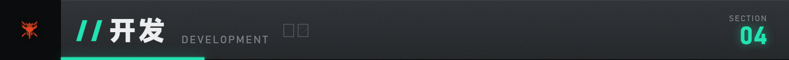

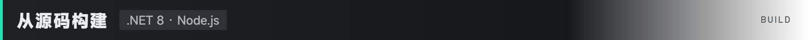

需要 .NET 8 SDK（或更新的 SDK）和 Node.js 20.19 / 22.12 以上。

```powershell
git clone https://github.com/LBEILC/StrongholdAssistant.git
cd StrongholdAssistant
npm --prefix src/ui ci
npm --prefix src/ui run build
dotnet run --project src/StrongholdAssistant.Host
```

| 目录 | 内容 |
| --- | --- |
| `src/ui/` | 侧栏界面：Vite + TypeScript + Svelte 5。`npm --prefix src/ui run dev` 可以在浏览器里用假数据单独开发界面。 |
| `src/StrongholdAssistant.Host/` | 宿主：WPF 窗口 + WebView2，消息桥，窗口跟踪与停靠，商店标记覆盖层。 |
| `src/ASPAssistant.Core/` | 识别、数据、阵容规划，来自上游项目。 |
| `data/` | 当期干员、装备、盟约等数据与识别资源。 |

界面和宿主之间的接口定义在 `src/ui/src/lib/api/types.ts`，消息协议写在同目录的 `bridge.ts`。

<br>

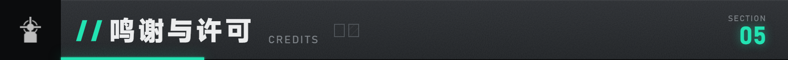

<table>
<tr>
<td width="120">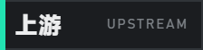</td>
<td>基于 <a href="https://github.com/bingyunhe/asp-assistant-arknights">bingyunhe/asp-assistant-arknights</a> 改造，它又基于 <a href="https://github.com/Moonfair/ASP_Assistant">Moonfair/ASP_Assistant</a>。识别、数据和阵容规划沿用上游，本项目重做了界面与交互。阵容规划由 <a href="https://github.com/CarlosDJY">CarlosDJY</a> 贡献给上游。MuMu 模拟器支持参考了 <a href="https://github.com/hesperine">hesperine</a> 给上游的 PR。</td>
</tr>
<tr>
<td></td>
<td>图像识别 <a href="https://github.com/MaaXYZ/MaaFramework">MaaFramework</a>；游戏数据 <a href="https://prts.wiki">PRTS</a>、SPDatabase；界面素材 <a href="https://github.com/ArknightsAssets/ArknightsAssets2">ArknightsAssets</a>；图标 <a href="https://remixicon.com">Remix Icon</a>；字体 <a href="https://hyperos.mi.com/font">MiSans</a>。</td>
</tr>
<tr>
<td></td>
<td>QQ 交流群 <b>1132134217</b>：<a href="https://qm.qq.com/q/AuRBCSxWEg">点击链接加入群聊【卫戍小助手StrongholdAssistant交流群】</a>。使用问题和建议也可以在 <a href="https://github.com/LBEILC/StrongholdAssistant/issues">Issues</a> 提；识别不了的话，附上设置里导出的诊断包最好。</td>
</tr>
<tr>
<td></td>
<td>代码以 <a href="LICENSE">Apache-2.0</a> 开源，上游的许可与声明保留在 <a href="LICENSE.upstream">LICENSE.upstream</a> 和 <a href="NOTICE">NOTICE</a>。</td>
</tr>
<tr>
<td></td>
<td>游戏美术与数据归 <b>上海鹰角网络</b> 所有，来源与归属见 <a href="ASSETS.md">ASSETS.md</a>；权利方要求时会移除。字体、图标等第三方素材遵循各自的许可。</td>
</tr>
</table>

<sub>※ 非官方玩家自制工具，与鹰角网络无关。不收费。</sub>

<br>


<a href="https://github.com/LBEILC/StrongholdAssistant/issues"></a>
